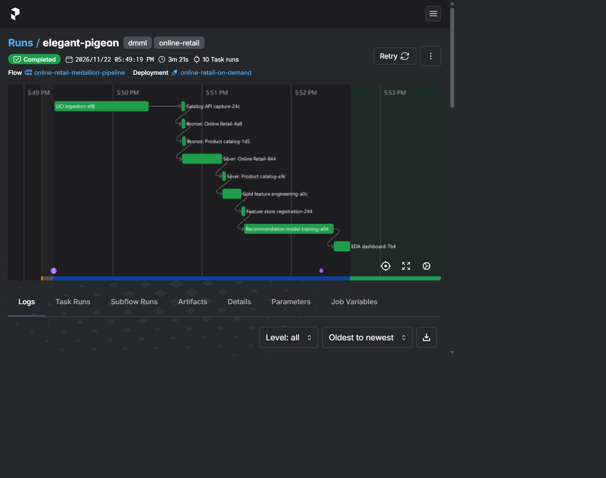

# Project Execution Evidence

## Prefect end-to-end pipeline run

- **Flow:** `online-retail-medallion-pipeline`
- **Deployment:** `online-retail-on-demand`
- **Run name:** `elegant-pigeon`
- **Run ID:** `0ccd9a0e-c49d-4a12-8de8-b9008c75331c`
- **Status:** Completed
- **Started:** 22 November 2026, 5:49:19 PM (local time)
- **Completed:** 22 November 2026, 5:52:39 PM (local time)
- **Duration:** 3 minutes 21 seconds (as displayed in the Prefect UI)
- **Task runs:** All 10 pipeline tasks completed

The Prefect flow executed these stages in order:

1. UCI ingestion and catalog API capture to Landing
2. Online Retail and product-catalog Bronze ingestion
3. Online Retail and product-catalog Silver processing
4. Gold feature engineering
5. Feature-store registration
6. Recommendation-model training and evaluation
7. EDA dashboard generation

The run was started with **Quick run** from the Prefect UI. The screenshot
shows its Completed status and completed task runs:

The Prefect UI identifies the run as `Completed` and shows all task runs as
completed. The screenshot is saved locally in this repository; the live run
details are available at [the local Prefect UI](http://127.0.0.1:4200/runs/flow-run/0ccd9a0e-c49d-4a12-8de8-b9008c75331c)
while the local Prefect server is running.

The quality summaries and output manifests are available under `../data/`.
The recommendation model and its separately tracked evaluation are documented
below.

## Exploratory analysis

The EDA script and methodology are documented in [`../eda/README.md`](../eda/README.md).
Generated plots and their machine-readable summary are in `../data/eda/`:

- [Open the latest EDA dashboard](../data/eda/index.html) after a pipeline run.
- The dashboard uses Silver for transaction-time trends and Gold for product
  popularity, customer diversity, and interaction sparsity; its charts are
  interactive and retain static PNG exports.
- `plots/interaction_patterns.png`
- `plots/item_popularity.png`
- `plots/interaction_sparsity.png`
- `summary.json`

## Feature store

The custom feature store and retrieval examples are documented in
[`../feature_store/README.md`](../feature_store/README.md). After Gold, Prefect
registers an immutable version under `../data/feature_store/`; its registry
records the active version, feature metadata, and snapshot lineage.

## Recommendation model

The item-item cosine recommender is documented in
[`../recommendation_model/README.md`](../recommendation_model/README.md).
Training uses a chronological Silver holdout, reports Precision@K, Recall@K,
and NDCG@K against a popularity baseline, saves a full-data inference model,
and tracks the run, parameters, metrics, and artifact checksums in the local
experiment store under `../data/model_tracking/`.

## Gold SQL schema

The SQLite/PostgreSQL-compatible schema for the three Gold feature tables is in
[`../sql/gold_schema.sql`](../sql/gold_schema.sql). It mirrors the Gold CSV
outputs and defines their keys, relationships, and basic data constraints.
After a successful Prefect run, `python -m gold.load_sqlite` verifies the
manifest and materializes `data/warehouse/online_retail.sqlite3`. This is a
post-run step; the Prefect flow still writes and versions the Gold CSVs.

## Remaining assignment work

- Data Quality PDF and final project report (deferred as requested).
- 5–10 minute walkthrough video (deferred as requested).
- Project ZIP and BITS-accessible Drive links (deferred as requested).
- If required for full scenario coverage: independent clickstream/product API
  sources and true near-real-time ingestion.
