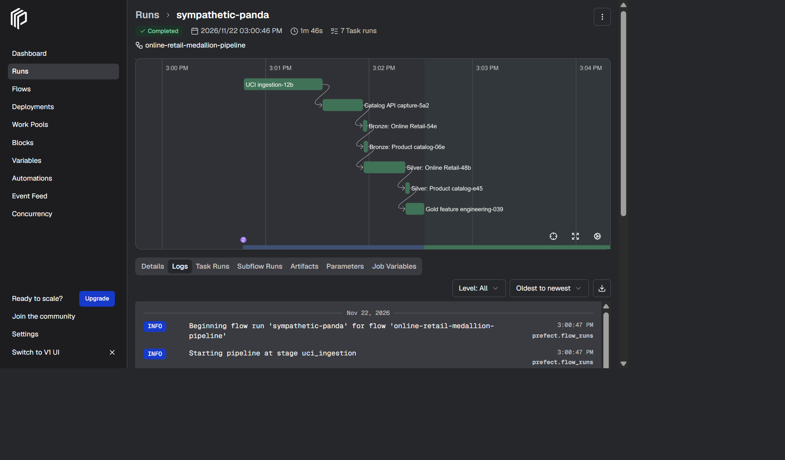

# Project Execution Evidence

## Prefect end-to-end pipeline run

- **Flow:** `online-retail-medallion-pipeline`
- **Run name:** `sympathetic-panda`
- **Run ID:** `20bb2870-5314-4322-ae2e-0220729e56a0`
- **Status:** Completed
- **Started:** 22 November 2026, 3:00:46 PM
- **Duration:** 1 minute 46 seconds
- **Task runs:** 7 completed

The Prefect flow executed these stages in order:

1. UCI ingestion to Landing
2. Catalog API capture to Landing
3. Online Retail and product-catalog Bronze ingestion
4. Online Retail and product-catalog Silver processing
5. Gold feature engineering

The Prefect UI screenshot shows the completed flow graph and task runs:

This screenshot predates the EDA and feature-store stages. The current flow
registers Gold features and then generates EDA as its final task. A Prefect run
resumed at Gold (`academic-earthworm`, `e6abe7db-8e96-48bb-91b9-22e87103ffa7`)
completed Gold followed by EDA before feature-store registration was added.
After feature-store integration, a run resumed at `feature_store`
(`determined-ant`, `59ec23d3-33dd-4312-939d-84f2b9e1f8d6`) completed
registration and the downstream EDA stage. A later run resumed at Gold
(`jade-goat`, `7e44f9c3-2146-477b-9b9b-bc67aeb875c6`) completed Gold,
registered a new feature version, and refreshed EDA. Two retained versions
were verified with pinned retrieval. The full pipeline from ingestion has not
yet been rerun with the newer stages.

The quality summaries and output manifests are available under `../data/`.
The recommendation model and its separately tracked evaluation are documented
below.

## Exploratory analysis

The EDA script and methodology are documented in [`../eda/README.md`](../eda/README.md).
Generated plots and their machine-readable summary are in `../data/eda/`:

- [Open the latest EDA dashboard](../data/eda/index.html) after a pipeline run.
- The dashboard uses Silver for transaction-time trends and Gold for product
  popularity, customer diversity, and interaction sparsity; its charts are
  interactive and retain static PNG exports.
- `plots/interaction_patterns.png`
- `plots/item_popularity.png`
- `plots/interaction_sparsity.png`
- `summary.json`

## Feature store

The custom feature store and retrieval examples are documented in
[`../feature_store/README.md`](../feature_store/README.md). After Gold, Prefect
registers an immutable version under `../data/feature_store/`; its registry
records the active version, feature metadata, and snapshot lineage.

## Recommendation model

The item-item cosine recommender is documented in
[`../recommendation_model/README.md`](../recommendation_model/README.md).
Training uses a chronological Silver holdout, reports Precision@K, Recall@K,
and NDCG@K against a popularity baseline, saves a full-data inference model,
and tracks the run, parameters, metrics, and artifact checksums in the local
experiment store under `../data/model_tracking/`.

## Remaining assignment work

- Data versioning workflow, such as DVC
- Data-quality PDF and final project report
- Walkthrough video, project ZIP, and accessible Drive links
